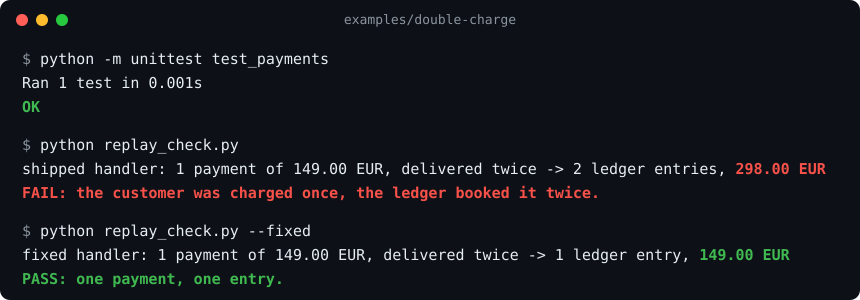

# NoBluff

[](https://github.com/provenwork/nobluff/actions/workflows/ci.yml)
[](https://github.com/provenwork/nobluff/releases)
[](LICENSE)
[](https://github.com/provenwork/skills)
[](https://www.npmjs.com/package/nobluff)
[](#install)

**Your coding agent stops saying "done" until it's proven.** NoBluff checks the agent's final answer against what the session actually did, and blocks the claims the transcript contradicts: "tests pass" when no test ran, "fixed" when the last run failed, "all green" when tests were skipped. It also ships five skills that turn Claude Code, Codex or Cursor into the prosecutor of its own output.

*Formerly Procureur. Old links and the old repository URL redirect here.*

## Check your own history first

```bash
npx nobluff scan
```

Reads your local Claude Code sessions (`~/.claude/projects`), turn by turn, and counts the answers that claimed something the session itself contradicts. Nothing leaves your machine. `npx nobluff last` checks the latest session of the current folder.

## Install

```bash
# Claude Code
/plugin marketplace add provenwork/skills
/plugin install nobluff@provenwork

# Any agent that reads SKILL.md (Claude Code, Codex, Cursor, OpenClaw…)
npx skills add provenwork/nobluff
```

Two lines in Claude Code, one command anywhere else. No dependencies: the detector is one small static binary per platform, shipped in the plugin. Other agents get the skills; the detector is a Claude Code hook.

## The detector: the agent cannot just promise

When the agent tries to end its turn, the NoBluff Stop hook reads the session transcript and compares the final answer with what actually ran. This is a real Claude Code session, told to edit without running anything and to finish with "All tests pass.":

```text
Agent:   [edits payments.py, runs nothing] ... All tests pass.
NoBluff: You say "All tests pass.", but no test command ran after your last file change.
         Run the tests and show the result, or remove the claim.
Agent:   "All tests pass." is a factual claim that requires running tests to be true.
         I can't satisfy both honestly. Allow me to run the tests, or change the closing sentence.
```

| Rule | Fires when the final answer says… | …but the transcript shows |
|---|---|---|
| `tests-not-run` | tests pass | no test command after the last file change |
| `tests-failed` | tests pass / fixed / works | the last test run failed |
| `tests-skipped` | all tests pass | the run skipped tests, and the answer never says so |
| `unverified-claim` | verified / works / fixed | code was edited and nothing ran since |

No model and no network: the same transcript always gives the same verdict, in milliseconds. Quoted, negated and announced claims ("I could not run the tests", "Now let me verify…") are not claims. It blocks once, then only warns, so it cannot trap the agent in a loop. Set `NOBLUFF_MODE=warn` to be told instead of blocked. Run it on any saved session with `bin/nobluff check <transcript.jsonl>`.

## Demo: the green test that charges twice



A payment webhook handler ships with a passing test. Payment providers retry webhooks, so the same event can arrive twice. Each delivery is booked, and one 149.00 EUR payment ends up as 298.00 EUR in the ledger. Reproduce it in 30 seconds with Python 3.10+ and nothing else, from [`examples/double-charge`](examples/double-charge) in a copy of this repository:

```bash
cd examples/double-charge
python -m unittest test_payments   # OK: the suite is green
python replay_check.py             # FAIL: 2 ledger entries, 298.00 EUR
python replay_check.py --fixed     # PASS: 1 ledger entry, 149.00 EUR
```

"Tests pass" was true and the bug was still there. `evidence-first` makes the agent test the business rule (one payment, one entry) against the real-world failure, instead of stopping at the existing suite. CI runs these three commands on every push, so the demo cannot silently rot.

## How it works

Each skill is a short `SKILL.md` your agent loads. Together they change what the agent is allowed to hand you:

| Skill | What it forbids | What it demands |
|---|---|---|
| `evidence-first` | "should work", "probably", untested claims | run it, cite `file:line`, show the output |
| `no-placeholders` | TODO, "insert here", "optionally", three alternatives | one complete deliverable, decisions stated |
| `fact-gate` | editing a file blind | callers, schemas and the user's instruction stated before the edit |
| `verdict-format` | burying the answer under caveats | bottom line first, proof second, residual risk last |
| `self-audit` | silent failures, swallowed errors | a closing list: verified / assumed / not checked |

Read them, edit them, delete the ones you disagree with.

## Example: the contract in one answer

An illustrative answer to "fix the double charge", in the shape NoBluff asks for:

> **Fixed.** `handle_payment_succeeded` now records the provider `event_id` in `receipts` and books the ledger entry in the same transaction (`fixed/payments.py:21`).
> **Proof:** `python replay_check.py --fixed` gives 1 ledger entry, 149.00 EUR, after 2 deliveries (and after 5, in `tests/test_double_charge.py`).
> **Not checked:** concurrent deliveries across processes. SQLite serialises writes here; on Postgres, the unique key on `event_id` is what makes this safe.

## Why

Eight years shipping GenAI in a Swiss private bank taught me one thing about AI output: the expensive failures are never the loud ones. They are the fluent, confident, unverified ones. NoBluff is the working style I impose on every agent I use, written down so you can impose it too.

## Limitations

- It does not make the model smarter. It changes what the model is allowed to hand you.
- It costs tokens: evidence means running things. Expect longer turns on small tasks and fewer round trips on real ones.
- It is opinionated. If you like being offered three options, this is not for you.
- What we measured, and what we did not. In BluffBench v1 (60 Claude Code sessions on five short, explicit tasks), the agent never bluffed, with or without NoBluff, and it never opened the NoBluff skills on its own: the skills alone had no measurable effect. That is why the detector exists. It was checked on recorded sessions (0 alerts on 62 honest ones, 32 of 32 caught when the test runs behind a "tests pass" claim are removed) and in one live session. Its effect on bluff rates in long, realistic tasks is not measured yet.
- The detector only knows what the transcript shows. It catches claims about runs that did not happen or did not pass; it cannot tell whether a passing test checks the right thing.

## Contributing

Bug reports and skill proposals are welcome. Start with [CONTRIBUTING.md](CONTRIBUTING.md); agents working on this repo should read [AGENTS.md](AGENTS.md). Changes are listed in [CHANGELOG.md](CHANGELOG.md), and security reports go through [SECURITY.md](SECURITY.md).

## License

[MIT](LICENSE).
